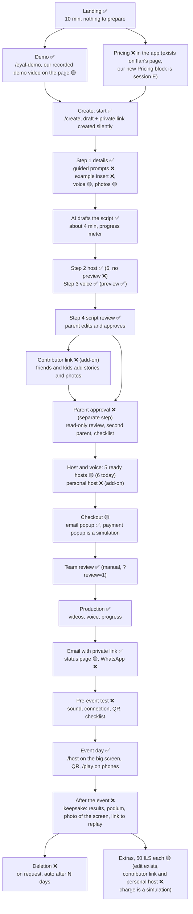

# Onboarding flow audit (session G)

Research only. No site code changed. Date of the audit: 2026-11-16.
App audited: `tadam.base44.app` (Ilan's Base44 app), mobile 390x844 and desktop 1440x900, he-IL.
Screenshots: `docs/onboarding-flow/*.webp` (about 330 KB in total). The private draft token is not recorded anywhere in this repo.

## 0. TL;DR

1. The wizard itself is **short and clear** (4 steps, autosave, resumes where you left). It is not the headache.
2. (Re-checked on 2026-11-16 against the live app and `main`: the wizard, checkout and terms code on tadam.base44.app is unchanged since the audit, only the game screen bundle was redeployed.) The headache is **what the parent is never told**: step 1 is a blank box, "המשך" silently starts an AI generation (about 4 minutes), the real "create" button leads to an email + payment popup, and then the game arrives **by email "within a few hours"** after a manual review by the team. None of this is on the landing page.
3. **Payment is not real today, and the price in the app is out of date.** The payment popup ("צעד אחרון ודי") has no card form and no payment provider in the code, and the site's own terms say: "בשלב הנוכחי מסך התשלום הוא הדמיה ואינו מחייב אמצעי תשלום". Also, the popup still has **₪250 / ₪50 hard-coded**, while Tanya's current decision (in `src/config/pricing.ts` on `main`) was **750 for the game and 50 for every extra** (since 2026-11-22 the price is 790) (edit, contributor link, personal host; 5 ready hosts included). Ilan's app must be changed to match. The numbers 250 and 50 in older sections below describe what the app shows today, not what we will charge.
4. **Missing entirely**: a contributor link for friends and kids, a parent approval step separate from the editor, a keepsake after the event, deletion, add-ons (personal host, contributor link), a host preview.
5. A real "after create" screen exists in code (progress, "ready", email with the private link, "copy private link"), but I could not see it live (see section 5).

## 1. Step by step map

Time is for a parent who has the details in their head. "Prepare" is what they need before starting.

| # | Screen | What the parent does | Time | Prepare in advance |
|---|---|---|---|---|
| 0 | Landing `/` | Reads, taps "בואו נתחיל" (to `/create`) or "לצפייה בדוגמה" (to `/eyal-demo?autostart=1`) | 1 to 3 min | nothing |
| 1 | Event details | Writes or records details about the celebrants, optionally up to 5 photos (each with a caption), sets 6 to 12 questions (default 9) | 5 to 15 min | the stories, nicknames, names of family and friends, favorite songs and movies, 1 to 5 photos |
| (wait) | Background generation | Nothing. Tapping "המשך" calls `generate`: an AI drafts the script. Server estimate in the draft state: about 240 s. A meter with percent, stage label and ETA exists in the code | about 4 min | none |
| 2 | Choose host | Picks 1 of 6 hosts (static picture + one line) | 30 s | none |
| 3 | Choose voice | Picks 1 of 5 voices that match the host's gender, with a play button per voice | 1 min | none |
| 4 | Script review ("התסריט של המשחק מוכן!") | Edits title, opening, every question (text, 4 options, correct one, reveal text, transition), swaps photos, picks a YouTube clip for song questions, can ask to rewrite with an instruction, can edit name pronunciation, deletes or reorders questions | 5 to 15 min | an eye for facts and names |
| 4b | "צור משחק!" (NOT clicked, read from the source) | Checks limits, then opens a popup: email, then payment, then success | 1 to 2 min | an email address |
| 5 | After payment | "התשלום התקבל בהצלחה! אנחנו נשלח לכם את המשחק המוכן תוך שעות ספורות" | hours of waiting | none |
| 6 | Team review, production | Team opens a review link (`&review=1`), button "צור משחק באמת הפעם", then videos are produced ("X מתוך Y סרטונים מוכנים, אפשר לסגור את העמוד") | hours | none |
| 7 | Email | Link to the game ("טדאם! המשחק שלכם מוכן"), page offers "לפתיחת המשחק" and "העתקת הקישור הפרטי" | n/a | check the email, spam folder |
| 8 | Event day | Open `/host/<id>` on the computer connected to the big screen, press start, guests scan the QR and open `/play/<id>` | 5 min setup | computer + screen/projector + speakers + internet, test beforehand |

Total active time for the parent: about **15 to 35 minutes**, split into two sittings (before and after the generation), plus waiting for the game.

### Screenshots

Landing: `00-landing-m`, `20-landing-d`.

Step 1: `01-step1-empty-m` (blank box, guidance text under it), `03-step1-example-m` (the "דוגמה" accordion), `04-step1-recording-m` (recording active), `05-step1-photos-m` (photo captions; thumbnails do not render in the sandbox, ignore the broken icons), `02-step1-validation-m` (empty "המשך"), `21-step1-d`.

Step 2: `06-step2-hosts-m`, `22-step2-d`. Step 3: `07-step3-voices-m` (shot with a female host selected), `08-step3-voices-female-host-m`, `23-step3-d`.

Step 4: `09-step4-script-m`, `10-step4-question-m`, `24-step4-d`.

Game: `11-host-lobby-d` (big screen, QR and "0 מחוברים"), `12-join-m` (phone join screen).

### Facts per screen

**Step 1.** One textarea ("כמה שיותר פרטים יותר טוב"), a long grey hint under it (names, age, hobbies, friends, school, siblings, parents, pets, "וואטאבר"), and a collapsed "דוגמה" with about 190 words about a bar mitzvah boy. Mic button "◉ אפשר גם להקליט" turns into "■ סיום הקלטה". The recording is sent for transcription and the text is put into the textarea (a 2 second tone returned an empty text and the UI showed nothing). Photos: jpeg, png, webp only, max 5, uploaded one after another (the button says "רק רגע…" meanwhile), each photo has a caption box. Questions stepper: 6 to 12, buttons just become disabled at the ends, no explanation. Empty "המשך" shows "ספרו לנו קצת יותר על האירוע כדי שנוכל להכין משחק אישי" in the bottom bar.

**Step 2.** Six hosts: עידו (classic, blue studio, default), גולי (cartoon character), נועה, ליאן, רועי, מנחם. The plan says 5 ready hosts; the app has 6. A host is a picture and one line. There is no preview of how the host looks or moves.

**Step 3.** Five voices per host, with a ▶ and a waveform. The list depends on the host (male host: עידו, עומר, דניאל, איתי, יונתן; female host: נועה, מאיה, תמר, יעל, שירה). A mismatch is blocked ("בחרו מנחה וקול תואם"). Previews are in step 3 only.

**Step 4.** Everything is editable, with character counters (title 100, opening 240, question 80, reveal 160, transition 60, ending 240) and an issues list under each question. Question types seen in the code: personal text, photo, song (YouTube clip with a chorus start time), and a movie scene with faces and bodies removed ("movie-ghost"). Rewrite-with-instruction, pronunciation list, delete, up and down exist.

**Autosave and resume.** The first visit to `/create` silently creates a draft and puts `?id=…#token` in the address bar. Every change is saved after about 1 second, to the server and to the browser. Returning to the same link (or the same browser) reopens on the right step; I verified that after reload the wizard reopened on step 4. Going back and forward without changing details does not call the AI again.

**Event day.** Big screen: logo, host, welcome text, QR, "N מחוברים", a start button that is disabled while it says "מכין את המשחק" and needs a tap to unlock sound and video, copy-link-for-guests, full screen, pause, restart, next and previous question, and an "עריכת המשחק" button. Phone: "ברוכים הבאים ל…", "איך לקרוא לכם?" (max 24 chars), "יאללה!". Photo questions ask for a typed answer; the end shows a podium and a personal score ("עניתם נכון על X מתוך Y").

## 2. Friction analysis

Rating is the chance a parent gets stuck or drops. "Fix" is the proposal.

| # | Where | Problem | Rating | Fix |
|---|---|---|---|---|
| 1 | Step 1 blank box | An empty big box, a wall of grey hint text, and the example is read-only (no "use this example" button), is bar mitzvah only, and names real artists and a real movie. Parents freeze or write two lines, and **two lines produce an empty game**: with the test text "בדיקה" the AI refused to invent, every question came out as "לא ניתן לכתוב שאלה ללא מידע מאומת" and options "לא סופק מידע" | High | Replace the box with 5 to 6 short prompts (name and age, 3 things they love, an inside joke, a story, siblings and friends). Show a counter ("עוד קצת, כדי שנוכל ליצור 9 שאלות") and a minimum of roughly 400 characters before "המשך". Add "הכניסו את הדוגמה" and an event-neutral example. |
| 2 | "המשך" in step 1 | It silently starts an AI generation. No warning that it costs time, no way to cancel, and changing the text later regenerates | Medium | Label it "יוצרים את התסריט" with one line "זה לוקח כמה דקות, אפשר להמשיך לבחור מנחה". Show the meter in steps 2 and 3. |
| 3 | Mic permission | If the mic is denied, the message "כדי להקליט צריך לאפשר גישה למיקרופון" is written in the error area at the **bottom of the page** (measured at y 1246 on a 844 high screen). The parent taps the mic at the top and nothing seems to happen | High | Show the message next to the mic button. In-app browsers (Instagram, WhatsApp) often block the mic, so also say "נסו לפתוח בכרום או בספארי". |
| 4 | Recording UX | No timer, no pulse, no length limit shown, no preview. An empty or failed transcript shows nothing at all | Medium | Timer + level meter, "לא שמענו כלום, נסו שוב" on empty text, show the transcript so it can be fixed. |
| 5 | Photos | Only 3 formats (an iPhone HEIC photo is silently not offered or rejected), up to 5, sequential upload with a disabled "המשך", per-photo caption box with no hint why it matters. I did not test a large file, so size limits are unverified | Medium | Accept HEIC and convert, parallel upload with progress, one line "תמונה עם כיתוב טוב הופכת לשאלה", an example caption. |
| 6 | 9 vs more questions | "כל שאלה נוספת זו בערך דקה נוספת" is the only guidance. Range 6 to 12 is only visible by disabled buttons. Nothing says that more questions need more material | Medium | Show "9 שאלות, בערך 12 דקות משחק" live, "12 שאלות מתאים לחתונה או לקהל גדול", and explain that more questions need more stories. |
| 7 | Host choice | No preview. Six cards, one is a cartoon, descriptions are vague ("אנרגיה של גמר"). Choosing is a guess | Medium | A 5 second muted clip or a voice line per host. Keep the generic hosts only (brief). Decide 5 or 6 (the plan says 5). |
| 8 | Voice choice | Good: there is a play button. But the voices are tied to the host's gender, and the five names are just first names | Low | Add a tag per voice (calm, energetic). Say once that voices follow the host. |
| 9 | No visible save or link | Autosave is silent. The private link lives only in the address bar and the same browser. "העתקת הקישור הפרטי" appears only after the game is created. Opening the link on another device or copying it without the part after `#` gives "הקישור לטיוטה אינו מלא" | High | Show "נשמר אוטומטית" and a "שלחו לי את הקישור למייל / לווטסאפ" button from step 1. Ask for the email early (it is needed anyway). |
| 10 | Errors | Any server failure shows "לא הצלחנו להתחבר. נסו שוב בעוד רגע." in the same bottom error area, so it can be off screen. The generic text does not say whether the work is saved | Medium | Toast at the top, "הכול נשמר, נסו שוב" with a retry button. The code has a good retry panel ("ההתקדמות שלכם נשמרה") only for failed generation. |
| 11 | Step 4 length and tone | 9 questions with 4 options each is a long form (9500 px on mobile). Counters are shown but there is no "all good" summary. The issue lines ("נדרש מקור אמיתי מאומת לידע כללי") are internal wording | Medium | Collapse the questions, one at a time with a "שאלה 3 מתוך 9" header, show a green "מוכן" mark, rewrite the issue messages for parents. |
| 12 | Approval | The parent's "approval" is just editing step 4 and pressing "צור משחק!". There is no read-only "this is how the game will look" and no way to show it to the other parent | Medium | A review screen with a share link for a second parent, and a checklist: names spelled right, facts right, photos allowed. |
| 13 | The final button | "צור משחק!" sounds like it creates the game now. In fact it opens an email popup, then a payment popup, then waits for the team | High | "לאישור והזמנה". Show the price and "תוך שעות ספורות נשלח לכם מייל" **before** the click. |
| 14 | Payment | It is a simulation (terms say so), no card form. If this goes live as is, parents will think they paid or will be asked twice | High | Decide a provider (not my decision, ask Tanya before any paid service). Until then say on the popup that this is a trial. |
| 15 | Waiting for the game | "תוך שעות ספורות" with a manual team review. No status page, no ETA. The email can land in spam; the code offers a fallback ("המשחק מוכן, אך שליחת המייל לא הצליחה. הקישור כאן נשמר") only in the same browser | High | Status page at the private link, an email "קיבלנו, זה ייקח עד X", WhatsApp as a second channel. Promise a deadline relative to the event date. Ask for the event date early. |
| 16 | Edit link | After publishing, the edit entry is the private link (`&edit` mode, button "עריכת המשחק" on the host screen) and the popup price becomes ₪50. Parents must know that **their private link is the edit key**: anyone with it can edit. The terms say the host and edit link is for organizers | Medium | Explain it in the email, a "שלחו לעצמכם" button, and a note that sharing it with guests is wrong (guests get the join link). |
| 17 | Contributors | There is no way for friends or kids to add questions or photos. Today one parent has to know everything | High (for the product) | New add-on, see flow. |
| 18 | Event day | The big screen needs a computer, a start tap to unlock sound, a QR scan. There is no "test mode" or checklist. The FAQ says to test beforehand, but no tool for it | Medium | A "בדיקת מערכת" screen (sound, connection, QR) and a printable one-page checklist. |
| 19 | Privacy | Photos of minors, names and answers are processed by Base44, Cloudflare, OpenAI, ElevenLabs, HeyGen and Resend, possibly outside Israel. The terms say there is **no automatic deletion** | Medium | A visible consent line at step 1 ("מעלים רק תמונות שיש לכם הרשאה להשתמש בהן") and a deletion promise (see flow). |
| 20 | Desktop | The wizard is the mobile layout centered. Hosts are in two columns, so 3 rows to scroll on a big screen | Low | Three columns on desktop. |
| 21 | Brief conflicts | The landing page has a block "מנחים מוכרים. אירועים מיוחדים" (famous hosts), which our brief forbids. The step 1 example names real artists. The movie question type shows a real film scene (faces removed) | Medium | Remove the block, replace the example, ask Tanya about the movie scenes. |

## 3. Proposed full flow

Legend: ✅ exists today in the app, 🟡 exists partly or as a simulation, ❌ missing.

### Where the payment happens

In the app it **does not happen** (price decision at the time: 750 base, 50 per extra; 790 since 2026-11-22, see section 0). The checkout popup (email, then "צעד אחרון ודי", "התשלום עבור המשחק הוא חד פעמי וכולל את כל מה שאתם צריכים", price hard-coded in the client as ₪250 for a new game and ₪50 when the game was already published (so it does not match the 750 decision), button "המשיכו לתשלום") calls a backend `checkout` action directly. The client code has no card fields, no redirect and no payment provider. The terms confirm "מסך התשלום הוא הדמיה". What the server does with `checkout` I could not see; the draft state then becomes "awaiting review". I did not click it.

Recommendation: collect payment **after the parent approves the script and before production** (that is where the real cost starts: voice and video). Show the price from the landing page on, and do not ask for payment in step 1 (too early, the parent has not seen any value).

### Proposed flow in words (what the parent sees)

1. **Landing.** Sees what it is, a demo, the price (from `pricing.ts`: 790 since 2026-11-22), the included 5 hosts, and how long it takes.
2. **Create.** Step 1 with guided prompts, then host, voice, script review. Every step says "נשמר" and how to come back.
3. **Optional add-on: contributor link.** A link to send to friends and kids to add stories and photos. They never see the answers.
4. **Parent approval.** One read-only screen with the whole game, shareable to a second parent, with a short checklist.
5. **Host and voice.** Five ready hosts. Personal host as an add-on (price proposals live in `src/config/pricing.ts`, they are proposals, not decided).
6. **Payment.** Real payment (provider to be chosen by Tanya) after approval, then a confirmation email with an ETA.
7. **We produce.** Status page, email when ready, deadline tied to the event date.
8. **Event day.** Test screen the day before, then big screen, QR, phones.
9. **After.** Keepsake page, deletion on request, edit for 50 ILS (as decided) through the private link.

## 4. Landing page UX copy (Hebrew, plural, no em-dashes, event-neutral)

1. `10 דקות להכנה, וזה מוכן` (title for the steps strip)
2. `לא צריך להכין כלום מראש. מספרים לנו, ואנחנו בונים את המשחק.`
3. `כותבים או מקליטים בקול, כמו שמספרים לחבר.`
4. `אפשר להתחיל, לעצור ולחזור בדיוק מאיפה שהפסקתם. הכול נשמר.`
5. `אתם עוברים על כל שאלה לפני שהמשחק מופק. שום דבר לא עולה למסך בלי אישור שלכם.`
6. `המשחק מגיע אליכם במייל, ומפעילים אותו מהמחשב. בלי אפליקציה ובלי הורדות.`
7. `האורחים מצטרפים מהטלפון בסריקת קוד אחד.`
8. `מחיר אחד ברור: {base} למשחק, עם מנחה מבין {readyMadeHosts} המנחים המוכנים. כל תוספת או עריכה: {edit}.`
9. `כדאי להתחיל כמה ימים לפני האירוע, כדי שיהיה זמן לבדוק את המסך והסאונד.`
10. `מעלים רק תמונות שיש לכם רשות להשתמש בהן. אפשר לבקש מחיקה בכל שלב.`

Note for B and E: line 8 uses the `{placeholders}` from `src/config/pricing.ts` (the page rule is that copy never contains a number), so it follows the price in `pricing.ts`. Line 9 depends on a promised production time that is not defined yet ("תוך שעות ספורות" is what the app says). Line 5 is true today only for the parent's own review; the team review comes after payment. Line 10 promises deletion on request; the terms say no automatic deletion, so keep "על פי בקשה" and align the terms.

## 5. What I could not verify, and what I touched

**Sandbox limits.** `actors.base44-realtime.dev` and `shtoot-demo.leibov.workers.dev` are not reachable from this environment (no response). So the game never starts here: I saw the big screen lobby (QR, host, "מכין את המשחק") and the phone join screen, but not questions, scoring, the podium, or the edit entry on the host screen. Those parts come from the app source and from `public/demo/tadam-demo.mp4`. I also did not see the generation wait screen, the checkout popup, the "game is ready" screen, the email, or the team review page; they are described from the app source, so wording is exact but layout is not confirmed.

**Real content test.** All my tests used the text "בדיקה". So the quality of the script from real details is not judged here. Someone should run one real story end to end.

**What I changed in Tanya's draft (the link from the brief).**
- Step 1 "המשך" was pressed once with the text "בדיקה - אין לטפל, זו בדיקת ממשק". That **started a backend AI generation** (I only found this after the click; it is how the app works). It produced a script of 9 placeholder questions. It cost one AI run, no email was set, nobody was notified, and I did not touch the final create or the checkout.
- After that, I blocked every backend action except load and autosave in the browser.
- I also uploaded 3 fake photos (removed from the draft afterwards) and recorded a 2 second tone for transcription. The 3 fake image files may remain in the Base44 storage.
- I changed the host and voice while testing and set them back to עידו and עידו. The question count is back at 9.
- **The draft now contains the text "בדיקה" and a placeholder script**, so Tanya may prefer "משחק חדש" for a clean start.

## 6. Suggested next steps (for Tanya's decision)

0. Tell Ilan to align the checkout popup with `pricing.ts` (790 since 2026-11-22). `docs/PLAN.md` on `main` still says 250 / 50 are the real numbers; it is stale.

1. Decide the real payment point and provider (a paid service, so not mine to choose) and whether the team review stays manual.
2. Decide the delivery promise (hours or a fixed deadline) so the landing copy can state it.
3. Specify the contributor link and the keepsake (scope and price).
4. Ask Ilan: step 1 guided prompts, mic message placement, a host preview, 5 vs 6 hosts, a deletion policy.
5. Confirm the movie-scene question type and the "famous hosts" block against the brief.
